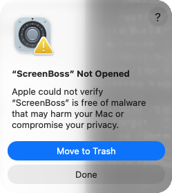
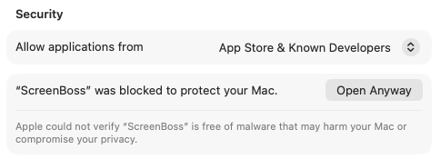
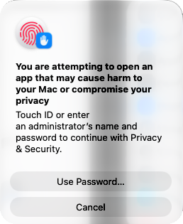
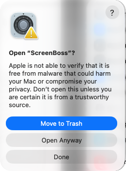

# Changelog

## 1.1.0

### New
- **App icon**: a new icon for Finder, Launchpad, and Applications.
- **Open at Login**: ScreenBoss adds itself to your login items the first time it runs
  from Applications. Turn it off with the **Open at Login** checkbox in the popover or
  in Preferences.
- **Preferences window**: click **Preferences…** in the popover.
- **Brightness keyboard shortcuts**: ⌃⌥↑ and ⌃⌥↓ (turn on in Preferences).
- **Per-display profiles**: save each display's resolution, refresh rate, and brightness,
  and restore them automatically at login.
- The menu bar icon now shows how many displays are connected.

### Install
Download `ScreenBoss-1.1.0.dmg`, open it, and drag **ScreenBoss** into **Applications**,
replacing the old copy. Quit the running ScreenBoss first.

### Allowing ScreenBoss to open
The app isn't signed with an Apple Developer ID, so macOS blocks it the first time.
You only need to allow it once.

**macOS 15 Sequoia and later**

1. Open ScreenBoss from Applications. When macOS blocks it, click **Done** (not
   *Move to Trash*).

   

2. Open **System Settings → Privacy & Security** and scroll down to **Security**.
3. Next to *"ScreenBoss" was blocked to protect your Mac*, click **Open Anyway**.
   The button only appears for about an hour after step 1.

   

4. Confirm with Touch ID, or click **Use Password…** and enter your Mac password.

   

5. In the *Open "ScreenBoss"?* dialog, click **Open Anyway**.

   

**macOS 13 Ventura and 14 Sonoma:** right-click the app → **Open**, then click **Open**.

See the [README](https://github.com/jayclark5150/ScreenBoss#allowing-screenboss-to-open)
for a Terminal alternative.

## 1.0.0

First release: brightness, resolution, refresh rate, True Tone, and Night Shift
controls for every display from the menu bar.
